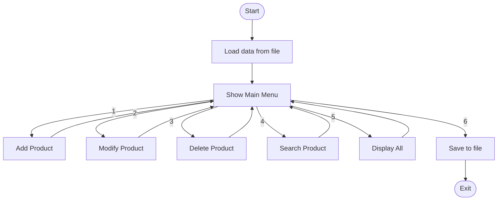

<div align="center">

# 📦 Inventory Store Management System

**A console-based inventory manager written in C with persistent file storage.**


[Features](#-features) • [Getting Started](#-getting-started) • [Usage](#-usage) • [Demo](#-demo) • [How It Works](#-how-it-works) • [Team](#-team)

</div>

---

## 📖 About

The **Inventory Store Management System** helps a small store keep track of its products from the terminal. You can add, modify, delete, search and display products, and everything is **saved to a file automatically** so your data is still there the next time you run the program.

It is built with plain C using structures, arrays, file handling (`fread` / `fwrite`) and a menu-driven interface, which makes it a good example project for learning C fundamentals.

---

## ✨ Features

| # | Feature | Description |
|---|---------|-------------|
| 1 | ➕ **Add Product** | Enter name, category, price and quantity. An ID is assigned automatically. |
| 2 | ✏️ **Modify Product** | Look up a product by ID and update all of its details. |
| 3 | 🗑️ **Delete Product** | Remove a product after a `y/n` confirmation. IDs are renumbered afterwards. |
| 4 | 🔍 **Search Product** | Find products by **ID** or by exact **Name**. |
| 5 | 📋 **Display All** | Show every product in a formatted table with a total count. |
| 6 | 💾 **Save and Exit** | Write all data to disk and quit. |

Extra details:

- 🧾 Names and categories can contain **spaces** (e.g. `Basmati Rice`).
- 🔁 Data is **loaded automatically** on startup.
- 🛡️ Handles the **empty inventory** and **inventory full** cases.
- 📦 Stores up to **100 products** (`MAX`).

---

## 🗂️ Project Structure

```
📁 inventory-management/
├── 📄 Inventory_store_management_using_C.C   # Source code
├── ⚙️ 7A.EXE                                 # Compiled executable (Windows/DOS)
├── 💽 inventory.dat                          # Sample saved inventory data
└── 📄 README.md                              # You are here
```

---

## 🚀 Getting Started

### Prerequisites

This project uses `<conio.h>` functions (`clrscr()`, `getche()`), so it needs a compiler that supports them:

- **Turbo C / Turbo C++** (recommended)
- **Dev-C++ / Code::Blocks (MinGW)**, which may need small tweaks (see the note below)

### Option 1: Run the executable

1. Download or clone the repository.
2. Double-click **`7A.EXE`**, or run it from a terminal / DOSBox:

```bash
7A.EXE
```

### Option 2: Compile from source

<details>
<summary><b>🔧 Turbo C / Turbo C++</b></summary>

1. Open `Inventory_store_management_using_C.C` in Turbo C.
2. Press `Alt + F9` to compile.
3. Press `Ctrl + F9` to run.

</details>

<details>
<summary><b>🔧 GCC / MinGW (Windows)</b></summary>

```bash
gcc Inventory_store_management_using_C.C -o inventory.exe
inventory.exe
```

> ⚠️ **Note:** `clrscr()` is not available in modern compilers. Replace it with `system("cls");`, include `<stdlib.h>` (already included), and change `void main()` to `int main()`.

</details>

<details>
<summary><b>🔧 DOSBox (for old Turbo C setups)</b></summary>

```text
mount c C:\TURBOC3
c:
cd bin
tc
```

Then open the source file and compile as in the Turbo C steps above.

</details>

---

## 🎮 Usage

When the program starts you will see the main menu:

```text
===== MAIN MENU =====
1. Add Product
2. Modify Product
3. Delete Product
4. Search Product
5. Display All Products
6. Save and Exit
Enter your choice:
```

Type the number of the action you want and press **Enter**.

<details>
<summary><b>➕ Adding a product</b></summary>

```text
=== ADD NEW PRODUCT ===
Enter product name: Basmati Rice
Enter category: Grocery
Enter price: 120.50
Enter quantity: 40

Product added successfully!
```

</details>

<details>
<summary><b>✏️ Modifying a product</b></summary>

```text
=== MODIFY PRODUCT ===
Enter product ID to modify: 1

Current Details:
Name: Basmati Rice
Category: Grocery
Price: 120.50
Quantity: 40

Enter new details:
Enter product name: Basmati Rice 5kg
...
Product modified successfully!
```

</details>

<details>
<summary><b>🗑️ Deleting a product</b></summary>

```text
=== DELETE PRODUCT ===
Enter product ID to delete: 2
Product found: Notebook
Are you sure you want to delete? (y/n): y
Product deleted successfully!
```

</details>

<details>
<summary><b>🔍 Searching for a product</b></summary>

```text
=== SEARCH PRODUCT ===
1. Search by ID
2. Search by Name
Enter choice: 2
Enter product name: Notebook

Products Found:
ID: 2, Name: Notebook, Category: Stationery
Price: 45.00, Quantity: 100
```

</details>

---

## 🖥️ Demo

Example output of **Display All Products**:

```text
=== ALL PRODUCTS ===
ID      Name            Category                Price           Quantity
------------------------------------------------------------------
1       Basmati Rice    Grocery                 120.50          40
2       Notebook        Stationery              45.00           100
3       Ball Pen        Stationery              10.00           250

Total products: 3
```

---

## ⚙️ How It Works

### Data structure

Each product is stored in a `struct`, and all products live in a global array:

```c
struct Product {
    int   id;
    char  name[50];
    char  category[50];
    float price;
    int   quantity;
};

struct Product inventory[MAX];   // MAX = 100
```

### Program flow



### Functions

| Function | Purpose |
|----------|---------|
| `main()` | Loads saved data, clears the screen, starts the menu |
| `mainMenu()` | Displays the menu and dispatches to the other functions |
| `addProduct()` | Reads a new product and appends it to the array |
| `modifyProduct()` | Finds a product by ID and overwrites its fields |
| `deleteProduct()` | Removes a product, shifts the array and renumbers IDs |
| `searchProduct()` | Searches by ID or exact name |
| `displayProducts()` | Prints all products in a table |
| `saveToFile()` | Writes `count`, `next_id` and the product array in binary |
| `loadFromFile()` | Reads the saved data back and re-assigns sequential IDs |

### File storage

Data is stored in **binary** format using `fwrite` and read back with `fread`:

```text
[ count ][ next_id ][ Product 1 ][ Product 2 ] ... [ Product N ]
   int       int      struct         struct            struct
```

> 📌 The program reads and writes a file named **`inventory.txt`** in the same folder as the executable. Because it is binary, it will not be readable in a text editor. The included `inventory.dat` is a sample data file; rename it to `inventory.txt` to preload the data.

---

## ⚠️ Limitations

- Maximum of **100 products**.
- Name search is **exact match** and case-sensitive.
- Product IDs are **renumbered** after a deletion or reload, so they are not permanent.
- Uses Turbo C specific functions (`clrscr`, `getche`), so it needs small changes to build on modern compilers.
- No input validation for non-numeric entries in numeric fields.

---

## 🔮 Future Improvements

- [ ] Partial and case-insensitive name search
- [ ] Sort products by price, quantity or name
- [ ] Low-stock alerts
- [ ] Input validation
- [ ] Dynamic memory allocation instead of a fixed array
- [ ] Export to CSV

---

## 🛠️ Concepts Used

`Structures` • `Arrays` • `Functions` • `Switch-case` • `Loops` • `File handling (fread / fwrite)` • `Strings`

---

## 👥 Team

| Name | Role |
|------|------|
| _Your Name_ | _Developer_ |
| _Teammate Name_ | _Developer_ |

---

## 🤝 Contributing

1. Fork the repository
2. Create a branch: `git checkout -b feature/your-feature`
3. Commit your changes: `git commit -m "Add your feature"`
4. Push the branch: `git push origin feature/your-feature`
5. Open a Pull Request

---

## 📜 License

This project is released under the [MIT License](LICENSE).

---

<div align="center">

⭐ If you found this project useful, give it a star!

</div>
